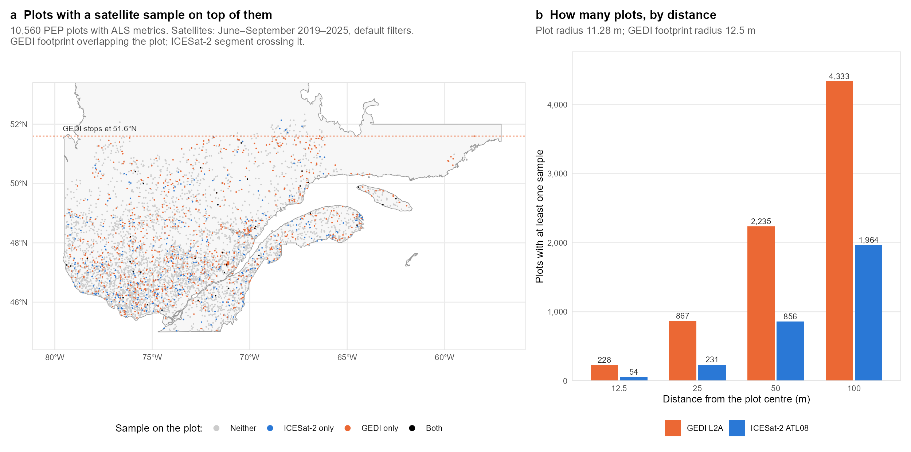
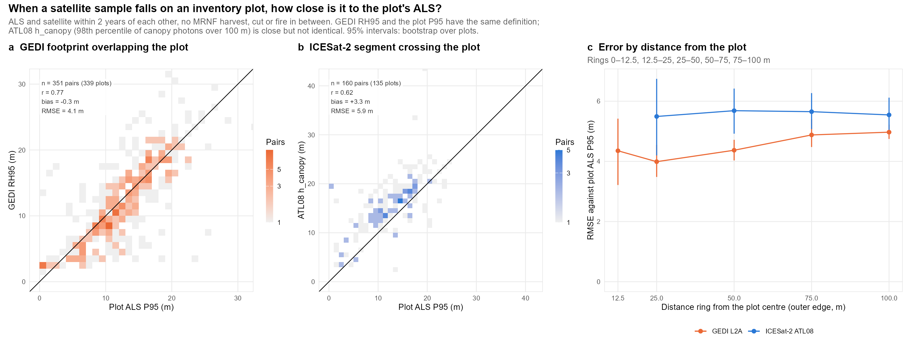

# 5. Agreement at the plot
{: .no_toc }

How many plots have a satellite sample on top of them, and how close is that sample to the plot's ALS?
{: .fs-5 .fw-300 }

1. TOC
{:toc}

All numbers below come from `outputs/numbers.txt`, written by `08_compare_figures.R`.

## 5.1 How many plots are covered

Over seven summers (June–September 2019–2025), after the default quality filters:

| Distance from the plot centre | Plots with GEDI | Plots with ICESat-2 |
|---|---|---|
| ≤ 12.5 m | 228 | 54 |
| ≤ 25 m | 867 | 231 |
| ≤ 50 m | 2,235 | 856 |
| ≤ 100 m | 4,333 | 1,964 |
| **On the plot** (GEDI footprint overlapping it; ICESat-2 segment crossing it) | **867** (8%) | **430** (4%) |

So about one plot in twelve has a GEDI footprint on it, and one in twenty-five an ICESat-2 segment. Only 35 plots
have both. GEDI covers more plots because it fires a footprint every ~60 m along 8 tracks, against ICESat-2's 3
strong beams. GEDI also loses many samples to its filters. Here 28% of the June–September shots carry the leaf-off flag (the
flag follows the average seasonal timing, not the actual date), and 22% of the remaining ones have a beam
sensitivity below 0.95. North of 51.6°N only ICESat-2 is available.

## 5.2 How close they are

Samples on the plot, with ALS and satellite at most 2 years apart and no MRNF event in between:

| Comparison | Plots | r | Mean difference | RMSE | MAE |
|---|---|---|---|---|---|
| GEDI RH95 vs plot ALS P95 | 339 | 0.77 | −0.3 m | 4.1 m | 2.8 m |
| GEDI RH50 vs plot ALS P50 | 339 | 0.59 | +0.3 m | 4.7 m | |
| ATL08 `h_canopy` vs plot ALS P95 | 135 | 0.62 | +3.3 m | 5.9 m | 4.3 m |

- **GEDI is unbiased for top height.** Half its footprints are within about ±2 m of the plot. The RMSE comes from
  the tails: 15% of the pairs differ by more than 5 m (5th–95th percentiles of the difference: −6.3 to +6.4 m).
- **ICESat-2 reads about 3 m higher than the plot P95.** This is expected, not an error: `h_canopy` is the 98th
  percentile of the canopy photons over a 100 m strip, while P95 covers all returns of a 400 m² circle. A longer
  strip meets more tall trees, and a higher percentile of canopy-only photons lands higher. 28% of the pairs differ
  by more than 5 m.
- **Distance matters for GEDI, little for ICESat-2.** The GEDI RMSE rises from 4.0 m at 12.5–25 m to 5.0 m at
  75–100 m. ICESat-2 stays near 5.5 m at all distances, because its 100 m segment already averages over the
  neighbourhood.

{: .note }
GEDI RH95 and the plot P95 are the same quantity: the height below which 95% of the lidar signal returns, counted
from the ground. The 4 m RMSE therefore measures what separates a satellite footprint from a plot: geolocation
(~10 m for GEDI), footprint shape and size (25 m Gaussian vs 22.6 m circle), waveform against discrete returns,
and up to 2 years of change.

{: .highlight }
**Why 4–6 m?** Page 6 cuts the airborne lidar to the exact ground of each satellite sample, in one region. On the
same ground, both satellites are unbiased, and most of the RMSE against a plot remains even with a perfect
satellite: it comes from comparing different ground.
