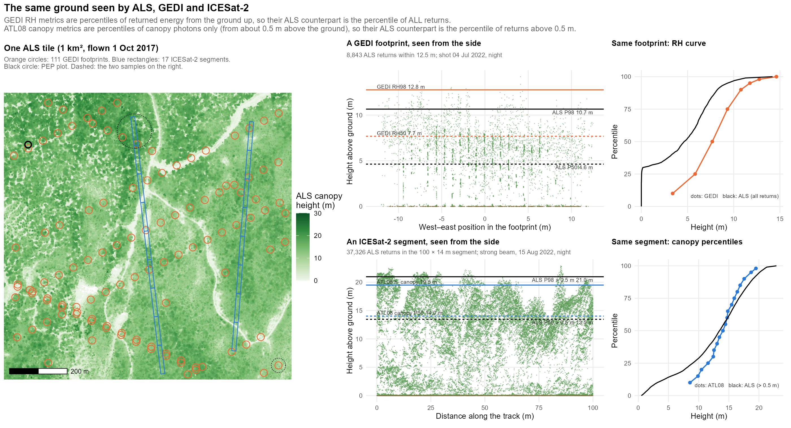
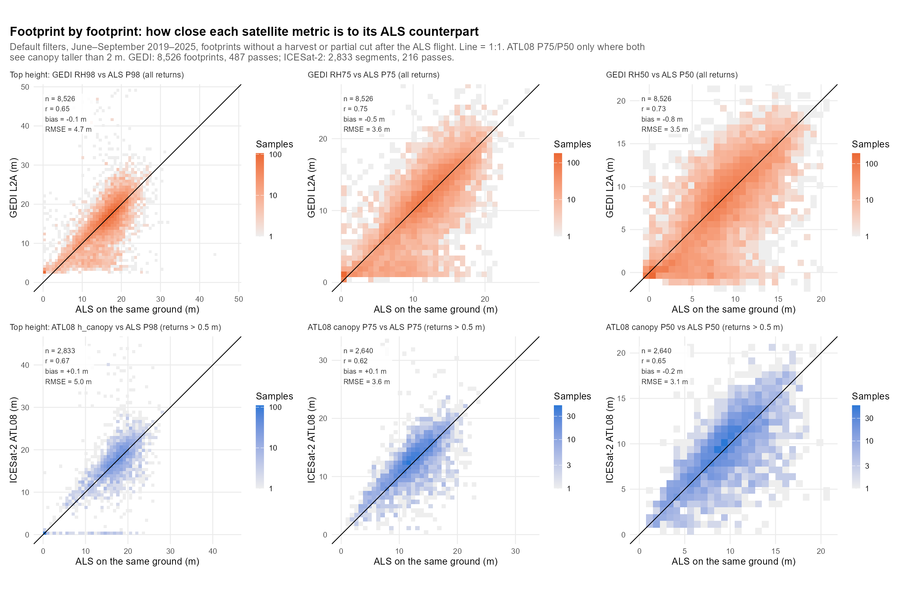
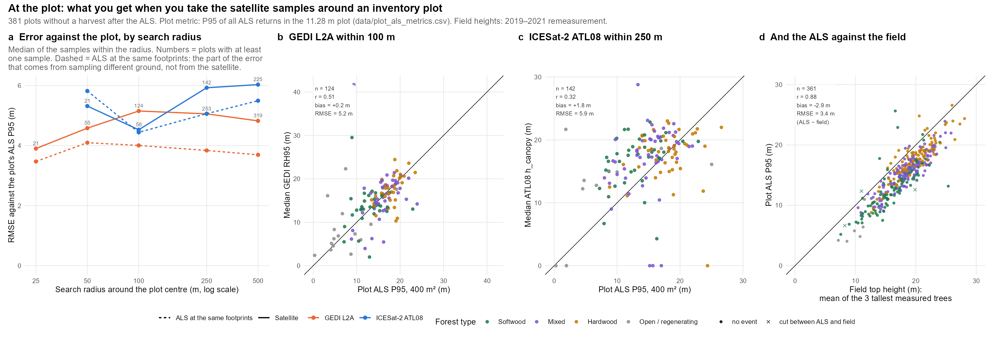

# 6. Why? The same ground, footprint by footprint
{: .no_toc }

Page 5 compared each satellite sample with a 400 m² plot. Here, in one region, the airborne lidar is cut to the
exact ground of each footprint. That separates what the satellite gets wrong from what is simply different ground.
{: .fs-5 .fw-300 }

1. TOC
{:toc}

## 6.1 The idea

At the plots (page 5), two things are mixed in every difference:

- **the satellite error:** waveform or photon processing, geolocation, filters;
- **the sampling difference:** a 25 m footprint or a 100 m × 14 m strip is not the same ground as an 11.28 m circle.

The ALS tiles that hold the plots cover far more ground than the plots: 1 km² or more each. So every satellite
sample that falls *inside a tile* can be compared with the ALS **on the same ground**. Clip the point cloud to the
GEDI circle or the ATL08 rectangle, and compute the ALS version of the satellite metric.

| Satellite metric | ALS counterpart on the same ground | Why |
|---|---|---|
| GEDI RH98, RH75, RH50 (25 m footprint) | Percentile 98, 75, 50 of **all** returns within 12.5 m | RH is a percentile of the returned energy, counted from the ground return |
| ATL08 `h_canopy` (100 m × ~14 m segment) | Percentile 98 of returns **above 0.5 m** in the segment rectangle | ATL08 labels photons as canopy from about 0.5 m above the ground (median `h_min_canopy` 0.64 m) |
| ATL08 canopy P75, P50 | Percentile 75, 50 of returns above 0.5 m | Same |

This is costly: every tile must be downloaded and read. So it is done in one region only, **the UPE 14–15 study
area** (12,644 km², 46.6–47.8°N, 73.6–76.1°W):

- **Plots:** 410 PEP plots with ALS (115 softwood, 144 mixed, 108 hardwood, 43 open or regenerating).
- **ALS:** 306 tiles (4.2 billion points), flown in late summer 2017 (leaf-on) or in spring 2018 (leaf-out).
- **Satellite samples inside the tiles:** 18,094 GEDI footprints and 4,784 ICESat-2 segments.

## 6.2 Footprint by footprint: the satellites are unbiased

With the default filters, June–September 2019–2025, and no harvest or partial cut after the ALS flight:

| Satellite vs ALS on the same ground | Samples | r | Mean difference | RMSE | Within ±3 m |
|---|---|---|---|---|---|
| GEDI RH98 vs ALS P98 of all returns | 8,526 | 0.65 | −0.1 m | 4.7 m | 69% |
| GEDI RH50 vs ALS P50 of all returns | 8,526 | 0.73 | −0.8 m | 3.5 m | 71% |
| ATL08 `h_canopy` vs ALS P98 of returns > 0.5 m | 2,833 | 0.67 | +0.1 m | 5.0 m | 71% |
| ATL08 canopy P50 vs ALS P50 of returns > 0.5 m | 2,640 | 0.65 | −0.2 m | 3.1 m | 79% |

- **The ~3 m offset of ICESat-2 at the plots is a matter of definition.** On its own ground and against the
  matching ALS definition, `h_canopy` is unbiased (+0.1 m). The offset of page 5 comes from comparing the P98 of a
  100 m strip with the P95 of a 400 m² circle.
- **Both sensors scatter by about 5 m RMSE for top height**, even on the same ground. About 70% of the samples are
  within ±3 m; the RMSE comes from a tail of large misses. Geolocation explains part of it; a few ICESat-2 segments missed
  the canopy altogether (the row at 0 m in the lower-left panel).
- **Lower percentiles agree better than top heights** (RMSE 3.1–3.6 m): they depend less on whether the one tallest
  crown is inside the footprint.
- The ALS of this processing matches the plot ALS table of page 2 at all 410 plots (P95 RMSE 0.13 m), although it
  uses the provider's ground classification instead of CSF.

## 6.3 At the plot: most of the error is different ground

Now take the satellite samples around each plot, as on page 5, and compare their median with the plot P95. Then
do the same with **the ALS at those same footprints** instead of the satellite values. The ALS version has no
satellite error at all; what remains is the sampling difference.

| Plot P95 vs the median of the samples within… | Plots | Satellite RMSE | ALS at the same footprints |
|---|---|---|---|
| GEDI, 25 m | 21 | 3.9 m | 3.5 m |
| GEDI, 100 m | 124 | 5.2 m | 4.0 m |
| GEDI, 500 m | 319 | 4.8 m | 3.7 m |
| ICESat-2, 100 m | 58 | 4.5 m | 4.4 m |
| ICESat-2, 250 m | 142 | 5.9 m | 5.1 m |

- **Most of the 4–6 m RMSE against a plot would remain with a perfect satellite.** For GEDI within 100 m, a
  flawless instrument would still be 4.0 m away from the plot P95; the satellite adds the rest (5.2 m in total).
- **For ICESat-2 the satellite adds almost nothing at 100 m** (4.5 against 4.4 m). Its offset against the plot
  (+1.8 m here) is entirely in the ALS at the same segments: it is the strip-versus-circle definition again.
- **The plot ALS itself sits 2.9 m below the field top height** (mean of the three tallest measured trees, 361
  plots, r = 0.88). Plot P95 is a percentile of all returns, not a dominant height.

## 6.4 What else the same-ground comparison shows

- **A harvest after the flight is easy to see.** Footprints in a stand-replacing harvest dated between the ALS and
  the satellite read 4.0 m lower than the ALS (median), and 46% of them more than 5 m lower. Partial cuts and
  tending barely move the top height. This supports filtering the pairs with the MRNF maps (page 4).
- **Growth after the flight is small here:** +0.05 m/yr (GEDI) and +0.07 m/yr (ICESat-2) in undisturbed
  footprints, 2017–2025.
- **The quality filters, checked against the ALS:**
  - GEDI shots with beam sensitivity between 0.90 and 0.95 read 1.8 m low, so dropping them is right.
  - GEDI shots flagged leaf-off are as good as the others (bias +0.2 m, MAE 2.8 m) in these June–September data.
    The flag follows the average seasonal timing, so here it drops 5,491 good shots.
  - ICESat-2 weak beams miss the canopy in 7% of the segments (2% for strong beams), and their MAE is 4.3 m
    against 2.8 m. Strong beams only is right.

Figures 11, 14, 15, 16 and 18 (study design, forest type and season, delay and disturbance, filters, tile-level
polygon metrics) are written by the same script, in `docs/assets/img/why/`.

## 6.5 Run it

The three scripts of this page are in the repository. The tables they produce are provided in `data/why/`, so
step 11 runs in about a minute without downloading anything. Only figure 12 needs one LAZ tile.

| Step | Script | Input | Time |
|---|---|---|---|
| 9a | `python -I scripts/09_footprint_inputs.py --tiles-only` | plot ALS table, study area | seconds |
| – | `05_get_spaceborne_lidar.py data/study_area/upe1415_study_area.shp --product gedi02a` (and `atl08`), `--years 2019-2025 --months 6-9 --out data/derived/why/<product>.parquet` | study area | ~15 min each |
| – | `TILE_LIST=data/derived/why/tiles_needed.csv Rscript scripts/02_download_laz.R` | step 1 | 306 tiles, 23.5 GB |
| 9b | `python -I scripts/09_footprint_inputs.py` | the above, PEP GeoPackage, MRNF WFS | ~10 min |
| 10 | `WORKERS=6 Rscript scripts/10_als_at_footprints.R` | LAZ tiles | ~4.5 h |
| 11 | `Rscript scripts/11_footprint_figures.R` | `data/derived/why/` if present, else `data/why/` | ~1 min |

Checks: `Rscript scripts/check_data.R 9 10 11`.

{: .note }
Steps 9 and 10 need the whole region's satellite samples, not only those near the plots: every footprint inside
an ALS tile counts, wherever the plot is. The masked download of page 3 would keep only those within 150 m of a
plot, about one in ten.
