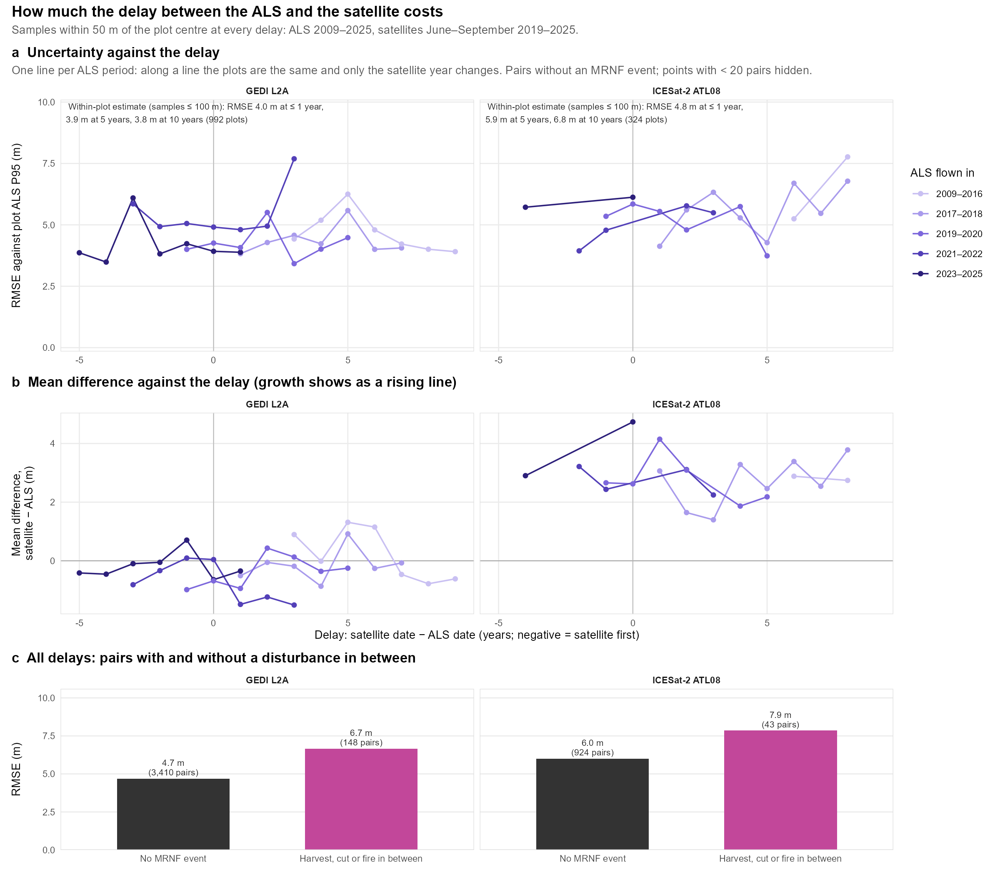
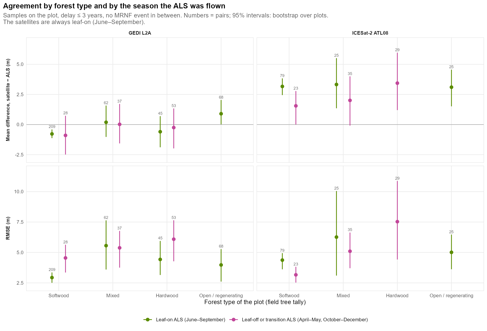

# 7. Delay, disturbance and season
{: .no_toc }

How much uncertainty does each year between the ALS flight and the satellite add? And how does that compare with a
harvest in between, the forest type, or an ALS flown with the leaves off?
{: .fs-5 .fw-300 }

1. TOC
{:toc}

## 7.1 The delay

**Why not simply plot the error against the delay?** Each region of Québec was flown in a different year. A plot of
error against delay across all plots would mix the effect of the delay with the effect of the region: its forest,
terrain and lidar project. Two ways around this:

- **One line per ALS period (panels a, b).** Along one line the plots stay the same and only the satellite year
  changes. Samples within 50 m of the plot are used, to have enough pairs per year.
- **A within-plot estimate (numbers in panel a).** Only plots seen by the satellite at two or more different delays
  are used, and each plot's own mean is removed before the slope is fitted. What remains is how the error of *the
  same plot* changes with the delay. Samples within 100 m are used: their extra spatial mismatch is a constant per
  plot, so it is removed with the mean.

| | GEDI L2A | ICESat-2 ATL08 |
|---|---|---|
| Plots seen at two or more delays | 992 | 324 |
| RMSE at a delay of ≤ 1 year | 4.0 m | 4.8 m |
| RMSE at 5 years (within-plot estimate) | 3.9 m | 5.9 m |
| RMSE at 10 years | 3.8 m | 6.8 m |
| Added squared error per year (95% interval) | −0.2 m² (−0.8 to 0.4) | +2.3 m² (1.1 to 3.5) |
| Drift of the mean difference per year | +0.01 m (−0.06 to 0.08) | +0.20 m (0.08 to 0.35) |

- **ICESat-2:** the error grows with the delay, by about 1 m of RMSE every five years. The mean difference drifts by
  +0.2 m per year, the order of height growth of Québec's forests. The satellite sees the forest that grew after
  the flight.
- **GEDI:** no measurable effect of the delay within 1–10 years. Its footprint-to-plot error (~4 m) is larger than
  what a few years of growth add.
- **Panel b:** the GEDI lines stay near zero at all delays. The ICESat-2 lines stay 2–4 m above zero (the
  `h_canopy` offset of page 5). Year to year they are too noisy to show the drift by eye; the within-plot estimate
  measures it.

## 7.2 A disturbance in between costs more than the delay

Pairs with an MRNF event between the two dates (harvest, partial cut, tending, fire, windthrow, ...):

| | GEDI L2A | ICESat-2 ATL08 |
|---|---|---|
| Pairs with an event in between (≤ 50 m) | 4.2% (148) | 4.4% (43) |
| RMSE without | 4.7 m | 6.0 m |
| RMSE with | 6.7 m | 7.9 m |

One recorded event between the ALS and the satellite adds as much RMSE as a decade of delay does for ICESat-2.
Drop these pairs, or update the ALS with the disturbance maps, before any comparison.

## 7.3 Forest type and the season of the ALS flight

Samples on the plot, delay ≤ 3 years, no event in between. Strata with fewer than 20 pairs are not shown.

| GEDI RH95 vs plot P95 | Leaf-on ALS (June–September) | Leaf-off or transition ALS |
|---|---|---|
| Softwood | RMSE **2.9 m** (209 pairs) | 4.5 m (28) |
| Mixed | 5.6 m (62) | 5.4 m (37) |
| Hardwood | 4.4 m (45) | 6.1 m (53) |
| Open / regenerating | 4.0 m (68) | – |

- **Softwood with a leaf-on ALS is the best case: GEDI RH95 within 2.9 m RMSE of the plot.** Conifer crowns look
  the same in every season, and their tops are sharp.
- **A leaf-off ALS over hardwoods misleads below the canopy top.** With leaf-on ALS, GEDI RH50 is 1.7 m *below* the
  plot P50 in hardwood plots. With leaf-off ALS it is 6.7 m *above* it. The bare crowns let the ALS reach the
  ground, which pulls its median height down, while GEDI flies leaf-on. Top heights (RH95, P95) are much less
  affected: the mean difference stays within ±1 m.
- **ICESat-2** keeps its ~3 m offset in every forest type. Its smallest RMSE is in softwood (3.2–4.4 m) and its
  largest in hardwood with a leaf-off ALS (7.5 m).

{: .important }
For any comparison below the canopy top (RH50, cover, vertical profile), use ALS flown with the leaves on. About a
quarter of Québec's plots (2,700 of 10,560) were flown in April–May or October–December.
