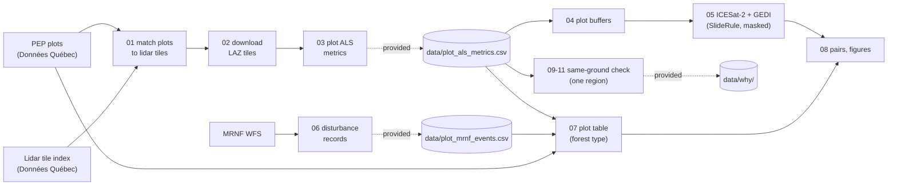

# ICESat-2 and GEDI against airborne lidar at Québec's permanent forest plots
{: .fs-8 }

How close are spaceborne lidar canopy heights to airborne lidar (ALS) on the ground they share, and how much
does the delay between the two acquisitions cost? A reproducible exercise on about 10,000 permanent sample plots.
{: .fs-5 .fw-300 }

[Start with the data](01_setup_and_data.html){: .btn .btn-primary .mr-2 } [Code on GitHub](https://github.com/joaoczarnecki/ICESAT_GEDI_ALS_FRI_QUEBEC_Exercise){: .btn }

---

## The question

Québec has two things few regions have at the same time:

- **Permanent sample plots (PEP):** about 12,800 plots of 400 m² (11.28 m radius), measured every ten years since 1970.
- **Airborne lidar over most of its managed forest:** flown between 2009 and 2025, with every 1 km tile free to download.

Two NASA spaceborne lidars have sampled the same forest since 2018–2019:

- **ICESat-2 ATL08:** canopy height per 100 m segment along each track.
- **GEDI L2A:** a 25 m footprint every 60 m along each track, south of 51.6°N.

Satellite samples rarely fall on a plot, and ALS and satellite were seldom acquired in the same year. This
exercise finds the plots where a satellite sample *does* fall on top of the plot, and asks three questions:

1. **Agreement:** how close are GEDI RH95 and ATL08 `h_canopy` to the plot's ALS 95th height percentile?
2. **Distance:** how fast does the agreement degrade when the sample lies 25, 50 or 100 m away from the plot?
3. **Delay:** how much uncertainty does each year between the ALS flight and the satellite add? And how does that
   compare with a harvest in between, the forest type, or an ALS flown with the leaves off?

## The steps

| Page | What you do | Scripts | Time |
|---|---|---|---|
| [1. Setup and data](01_setup_and_data.html) | Install Python and R packages, download the public data | `00_install_r_packages.R` | 30 min |
| [2. ALS metrics of each plot](02_als_plot_metrics.html) | Match plots to lidar tiles, download the tiles, extract the plot metrics | `01`, `02`, `03` | days (or skip: table provided) |
| [3. ICESat-2 and GEDI near the plots](03_satellite_download.html) | Download only the satellite samples within 150 m of a plot | `04`, `05` | 2–3 h |
| [4. Pairing plots and samples](04_pairing.html) | Forest type, disturbance records, plot–sample pairs | `06`, `07` | 1 h (or skip: events provided) |
| [5. Agreement at the plot](05_agreement.html) | How many plots, how close, how far | `08` | 3 min |
| [6. Why? The same ground](06_why_on_the_same_ground.html) | In one region, ALS cut to each footprint: satellite error vs different ground | `09`, `10`, `11` | 1 min (tables provided) or ~5 h |
| [7. Delay, disturbance and season](07_delay_and_season.html) | The cost of the delay, forest type, leaf-off ALS | `08` | – |
| [8. Lessons and limits](08_lessons.html) | What to remember before using these data | – | – |
| [9. Complete code](09_complete_code.html) | The knitted exercise: every script, run step by step, with its output | all | – |

**Fast track.** The repository includes the two expensive products: the plot ALS metrics and the MRNF disturbance records. You can
start at step 3 with only Python, R and an internet connection, and have every figure in about 3 hours.

**One file, step by step.** [`exercise.Rmd`](https://github.com/joaoczarnecki/ICESAT_GEDI_ALS_FRI_QUEBEC_Exercise/raw/main/exercise.Rmd)
holds the complete code of every script (R and Python) as chunks you can run one at a time, shows the result of
each step and checks its files. With the provided data, it knits in a few minutes.
[See the knitted result](exercise.html); its *Code* button at the top downloads the `.Rmd`.

[Download exercise.Rmd](https://github.com/joaoczarnecki/ICESAT_GEDI_ALS_FRI_QUEBEC_Exercise/raw/main/exercise.Rmd){: .btn .btn-primary .mr-2 } [Open the knitted exercise](exercise.html){: .btn }

## How to cite

Czarnecki de Liz, J. P., & Achim, A. (2026). *ICESat-2 and GEDI against airborne lidar at Québec's permanent forest plots: a
reproducible exercise* (v1.0.0). Zenodo. https://doi.org/10.5281/zenodo.24139153

This DOI always resolves to the latest version; each version also has its own DOI on the
[Zenodo record](https://doi.org/10.5281/zenodo.24139153). GitHub's *Cite this repository* button gives the same
citation in APA and BibTeX.

## Credits

Exercise and code by **João Paulo Czarnecki de Liz** (Université Laval), under the supervision of **Alexis Achim**
(Université Laval), developed with **Claude** (Anthropic) as a
coding assistant. Text and figures: CC BY 4.0; code: MIT.

Data:

- **PEP plots, airborne lidar and forest disturbance maps:** Ministère des Ressources naturelles et des Forêts du Québec (MRNF), CC BY 4.0.
- **ICESat-2 ATL08:** Neuenschwander et al., NSIDC.
- **GEDI L2A:** Dubayah et al., LP DAAC.
- **Access:** both satellite products through [SlideRule Earth](https://slideruleearth.io) (Shean et al. 2023).

Full references are on page 8.
